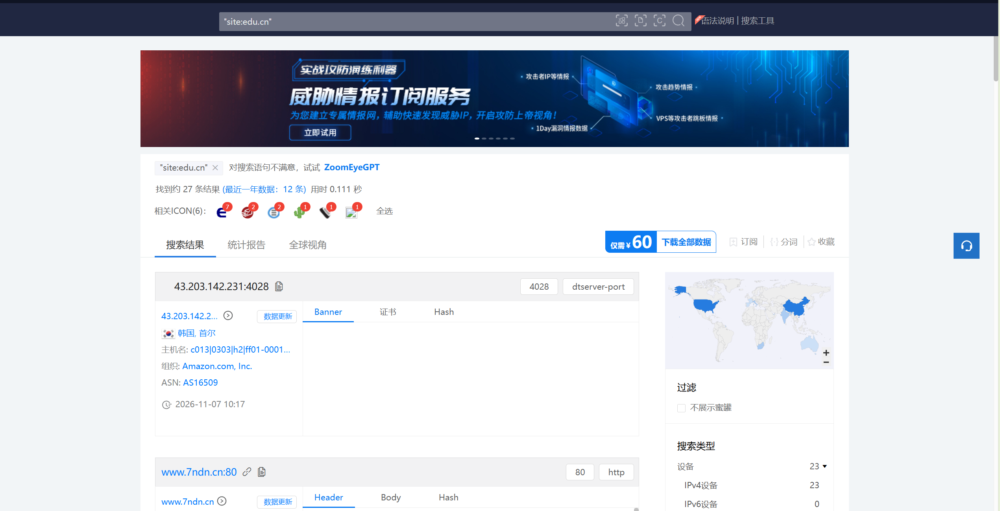
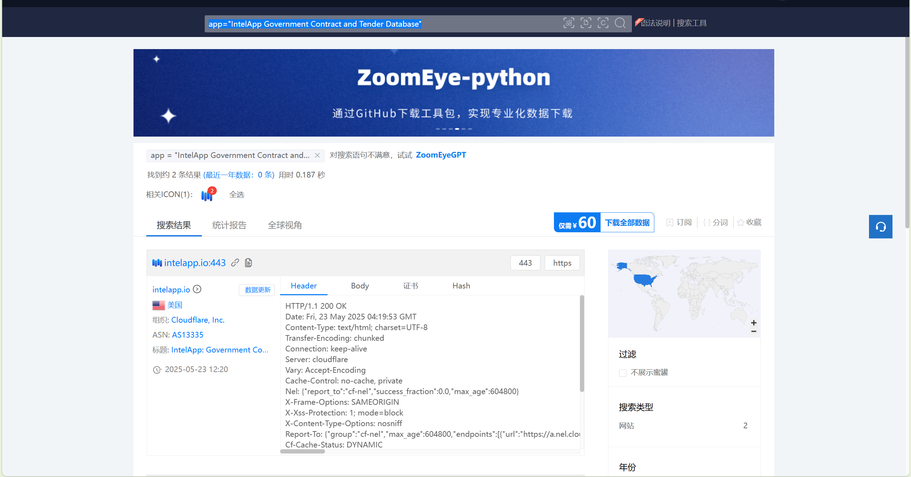
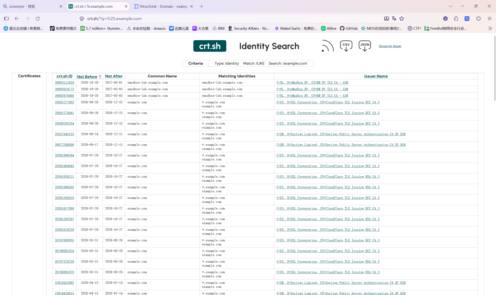
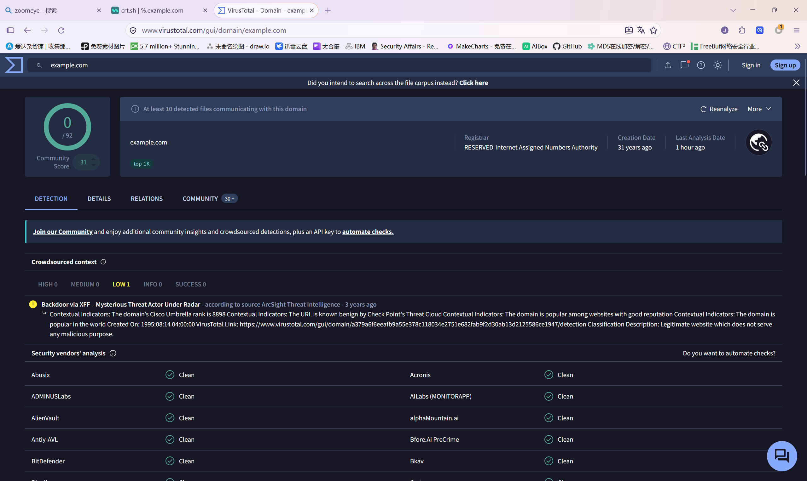
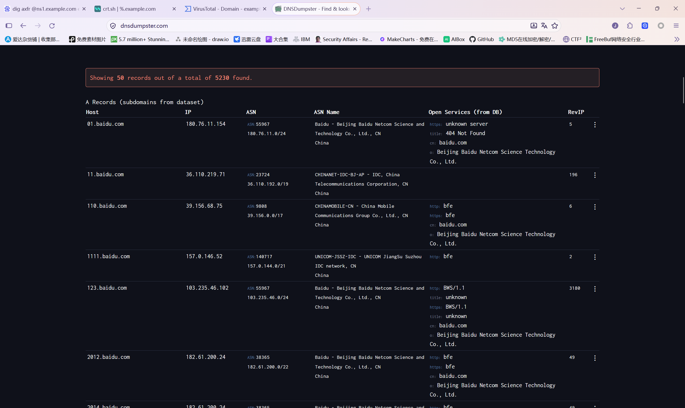
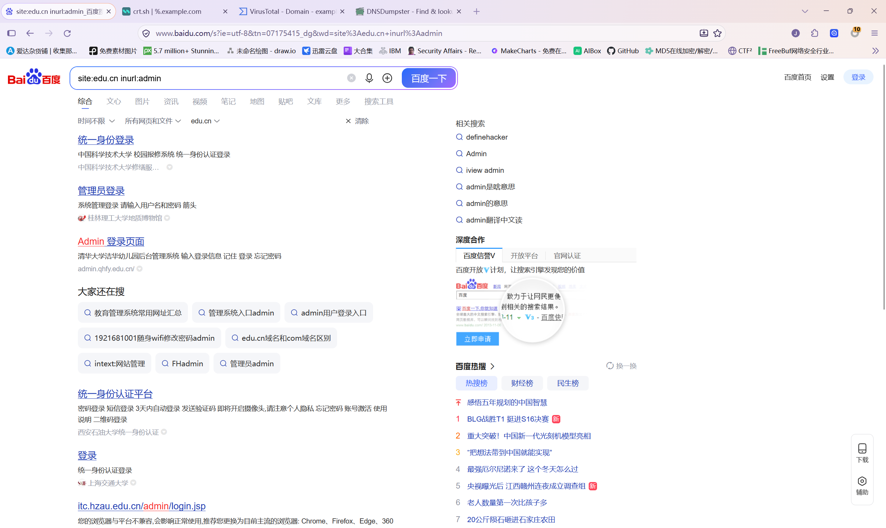

# 网络空间搜索引擎初探：ZoomEye 实操与子域名收集实践

> 课程作业记录：① 与 ZoomEye 功能类似的搜索引擎有哪些；② 结合 ZoomEye 进行相关搜索（附截图）；③ 如何进行子域名收集（附截图）。
> 
> ⚠️ 声明：本文所有搜索与信息收集操作仅用于学习交流，请在授权范围内进行测试，勿用于非法用途。

---

## 一、与 ZoomEye 功能类似的搜索引擎还有哪些？

ZoomEye 是知道创宇推出的**网络空间搜索引擎**，它通过持续扫描全球 IPv4 地址，对开放端口、服务组件（Web 指纹、设备指纹）进行识别与索引，可以被用来定位特定的服务器、网站、组件乃至摄像头等联网设备。

同类产品还有不少，常见的有：

| 搜索引擎                             | 出品方               | 特点简述                                                                   |
| -------------------------------- | ----------------- | ---------------------------------------------------------------------- |
| **Shodan**                       | John Matherly（美国） | 老牌网络空间搜索引擎，主打物联网设备、工控系统（ICS）、开放服务等，数据以 Banner 为主                       |
| **Censys**                       | 美国（起源于密歇根大学）      | 基于 TLS 证书与协议扫描，对 HTTPS/证书链分析支持很好，学术研究背景强                               |
| **FOFA**                         | 白帽汇（中国）           | 国内使用非常广泛，支持极强的资产关联检索（如 `title`、`header`、`body`、`icon_hash`），适合渗透前的资产梳理 |
| **Quake（360 Quake）**             | 360（中国）         | 360 旗下空间测绘平台，数据更新较快，提供命令行与 API                                         |
| **鹰图平台 Hunter**                  | 奇安信（中国）           | 面向企业资产测绘，对国内资产的覆盖与关联较好                                                 |
| **BinaryEdge**                   | BinaryEdge（葡萄牙）   | 主打资产扫描与威胁情报数据订阅                                                        |
| **ONYPHE**                       | ONYPHE（法国）        | 偏威胁情报方向，索引物联网、SCADA 等设备                                                |
| **Netlas.io**                    | Netlas（拉脱维亚）      | 类 Shodan，免费额度较友好，响应数据结构清晰                                              |
| **Fofa 国际版 / Leakix / Fullhunt** | 各家                | 均属于网络空间测绘/攻击面管理类平台，可作为补充                                               |

> 小结：这类工具的思路都是「**把整个互联网当作可检索的数据库**」，差异主要在于扫描协议的覆盖面、指纹库的质量、数据的更新频率以及使用门槛。国内做资产收集用 ZoomEye / FOFA / Quake / Hunter 较多，国际研究则常用 Shodan / Censys。

---

## 二、结合 ZoomEye 进行相关搜索

### 2.1 ZoomEye 常用搜索语法

ZoomEye 支持多种过滤条件组合，常用的有：

| 语法                   | 含义          | 示例                                |
| -------------------- | ----------- | --------------------------------- |
| `site:`              | 搜索特定站点/域名   | `site:example.com`                |
| `ip:`                | 指定 IP 或网段   | `ip:1.2.3.4` / `ip:1.2.3.4/24`    |
| `port:`              | 指定开放端口      | `port:6379`                       |
| `service:`           | 指定服务协议      | `service:mysql` / `service:redis` |
| `app:`               | 指定组件/应用指纹   | `app:"Apache httpd"`              |
| `os:`                | 指定操作系统      | `os:"Windows Server 2008"`        |
| `title:`             | 网页标题关键字     | `title:"后台管理"`                    |
| `header:`            | HTTP 响应头关键字 | `header:"nginx"`                  |
| `country:`           | 限定国家/地区     | `country:cn`                      |
| `after:` / `before:` | 限定数据收录时间    | `after:"2025-01-01"`              |

多个条件之间用**空格**连接即可实现「与」查询，例如：

```text
app:"Jenkins" country:cn after:"2025-01-01"
service:redis port:6379 country:cn
title:"登录" app:"Tomcat"
```

### 2.2 实操示例

**示例 1：检索域名为 edu.cn 的资产**

在 ZoomEye 搜索框中输入 `site:edu.cn`，返回域名归属 edu.cn 的资产。每条结果都可以直接看到开放端口、协议类型、Banner 信息、归属地与 ASN，用来了解某类系统在互联网上的部署面非常直观。



**示例 2：用组件指纹定位特定应用**

输入 `app="IntelApp Government Contract and Tender Database"`，按组件指纹检索这个政府采购与招标数据库系统在全球的暴露情况。本次只命中 2 条结果（`intelapp.io:443`，托管在 Cloudflare 之后，走 HTTPS），可以看出指纹检索的粒度——直接以"某应用"为索引去定位资产，而不是靠关键词碰运气。



> 💡 技巧：ZoomEye 每月给免费账户一定的搜索额度，批量查询建议使用其官方 API + 分页拉取，避免手工翻页浪费额度。

---

## 三、如何进行子域名收集

子域名收集是渗透测试信息收集阶段的第一步：**资产面越大，可尝试的攻击入口越多**。总体分为「**被动收集**」与「**主动收集**」两大类。

### 3.1 被动收集（不与目标直接交互）

**（1）证书透明度日志（CT Log）**

现代 HTTPS 证书必须公开记录，因此可以从 CT 日志里免费获取到大量子域名：

- 在线平台：[crt.sh](https://crt.sh)、Censys 证书搜索
- 直接 SQL 式查询：访问 `https://crt.sh/?q=%25.example.com`



**（2）第三方数据库/API**

- VirusTotal：`https://www.virustotal.com/#/domain/example.com`，在「关系（Relations）」标签页会列出该域名解析过的子域名：

  

- SecurityTrails、DNSDumpster（`dnsdumpster.com` 输入目标域名即可直接生成子域名与网络拓扑图，下图是它对 `baidu.com` 的 A 记录查询结果）：

  

**（3）搜索引擎语法**

利用 Google / Bing / 百度等搜索引擎的站点限定语法（以百度为例，`site:edu.cn inurl:admin` 可以搜到大量高校的管理登录入口）：

```text
site:*.example.com -www
site:edu.cn inurl:admin
```



### 3.2 主动收集（通过枚举/爆破与解析验证）

**（1）工具化枚举（推荐）**

- **subfinder**：纯被动 API 聚合，速度快、误报少
  
  ```bash
  subfinder -d example.com -o sub_passive.txt
  ```

- **OneForAll**：国产一体化子域名收集工具，被动+主动+解析验证+存活探测一条龙
  
  ```bash
  python oneforall.py --target example.com run
  ```

- **amass**（OWASP）：数据源极多，支持主动爆破与递归爬取，结果更全但更慢
  
  ```bash
  amass enum -d example.com -o amass_result.txt
  ```

- **Layer 域名挖掘机**：Windows 图形界面工具，适合快速字典爆破

**（2）字典爆破**

用字典 + 高并发 DNS 解析验证，常配合 `massdns` / `dnsx`：

```bash
# 用 dnsx 对字典进行并发解析验证
cat sub_domain_dict.txt | dnsx -d example.com -a -resp -o dnsx_result.txt
```

**（3）去重与存活验证**

收集到子域名后，一般还要做：

1. **解析验证**：过滤掉不存在的记录（CNAME / A 记录查询）；

2. **HTTP 存活探测**：用 `httpx` 批量确认 Web 服务是否存活：
   
   ```bash
   cat all_subdomains.txt | httpx -title -tech-detect -status-code
   ```

3. **指纹识别**：对存活资产进一步做组件识别（`wappalyzer`、`EHole` 等）。

### 3.3 收集流程小结

```text
目标域名
   ├─ 被动收集：CT日志 / VT / DNSDumpster / ZoomEye-FOFA / subfinder
   ├─ 主动收集：字典爆破（amass / Layer / dnsx）→ 并发解析验证
   ├─ 结果合并去重 → httpx 存活探测 → 指纹识别
   └─ 输出资产清单，进入下一阶段（端口扫描、目录爆破等）
```

---

## 四、总结

1. 网络空间搜索引擎（ZoomEye、Shodan、Censys、FOFA、Quake、Hunter 等）让「互联网资产」变成了可检索的数据，是攻击面管理和安全研究的基础设施；
2. ZoomEye 的价值在于其组件指纹库，善用 `site:`、`app:`、`port:` 等语法组合可以快速定位特定资产；
3. 子域名收集应遵循「先被动、后主动」的顺序，多数据源交叉验证，最后统一做解析与存活过滤，才能得到一份可信的资产清单。

> 再次强调：以上操作请务必仅在**授权测试**与**学习研究**的范围内进行。
